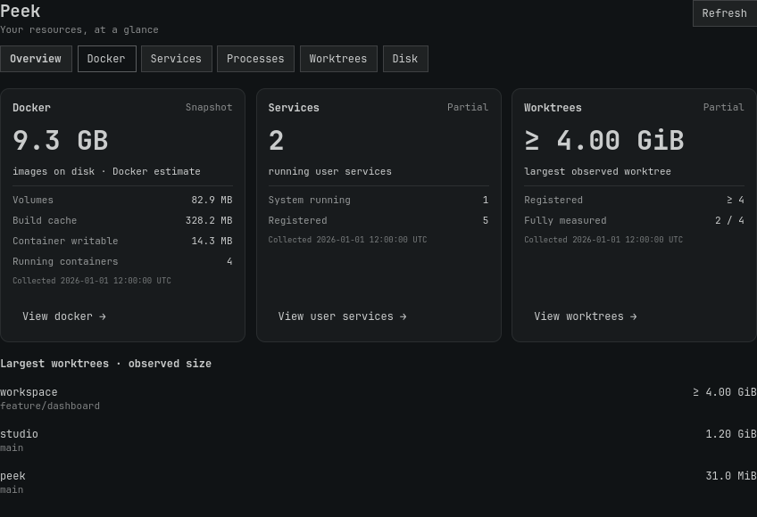

# Peek

**A quick look at your system, when you ask for it.**

Peek opens from the Omarchy bar with a compact **Overview** of Docker disk usage,
running services and worktrees. Each summary appears as its snapshot finishes.
Choose a section for resource lists, search and full details; **Refresh** takes a
new snapshot. Closing the panel stops active collection.



| Section | What it shows |
| --- | --- |
| Docker | Containers, ports, Compose projects, images, volumes and Docker disk usage |
| Services | System and user services, enablement and timers |
| Processes | Process names, PIDs, memory, working directories and listening sockets |
| Worktrees | Repository/worktree paths, branches, working-tree state and allocated size |
| Disk | Configured path sizes and a directory breakdown |

Results include collection time and visible errors or partial results. Peek is
read-only: it reports facts and provides no cleanup, scoring or recommendations.
It runs collectors only on demand, with no periodic polling or separate daemon.

## Install

Requires **Omarchy 4 with Omarchy Shell**, Quickshell and Python 3. Git, systemd,
and `ss` (iproute2) supply their corresponding sections. Bounded GNU `du` queries measure directory sizes when available, with a Python
fallback. Docker is optional; its section reports when the CLI or daemon is unavailable.

```sh
omarchy plugin add https://github.com/nachfq/omarchy-peek.git --enable
```

The installer uses the repository's default branch. GitHub release tags identify
validated versions; installation does not select the latest release tag.

Open **Peek** from the bar for the Overview, then choose a section for details. The data is
an on-demand snapshot, not a live monitor. Large directory scans can take longer
than service/process queries. Loading and incomplete states remain visible;
accounting notes and technical diagnostics are available on demand.

See [Usage and configuration](docs/USAGE.md) for choosing repository and disk
paths, and [Development](docs/DEVELOPMENT.md) for running checks.

## Update and remove

```sh
omarchy plugin update nachfq.peek
omarchy plugin disable nachfq.peek
omarchy plugin remove nachfq.peek
```

## Measurement limits

- Results are limited by your account's access. Peek does not request elevation.
- Docker uses your current Docker context, which may point to a remote daemon.
- Repository discovery is bounded to configured roots and depth. Configure your
  actual repository parent folders for the most useful worktree view.
- Allocated disk sizes are observations, not reclaimable-space estimates.
  Overlapping directories, hardlinks, Btrfs reflinks/compression and snapshots
  mean totals cannot necessarily be added or translated into free space.

Built on the native Omarchy plugin/UI conventions used by
[Yuragi](https://github.com/nachfq/omarchy-yuragi).

[MIT license](LICENSE) · [Issues](https://github.com/nachfq/omarchy-peek/issues)
